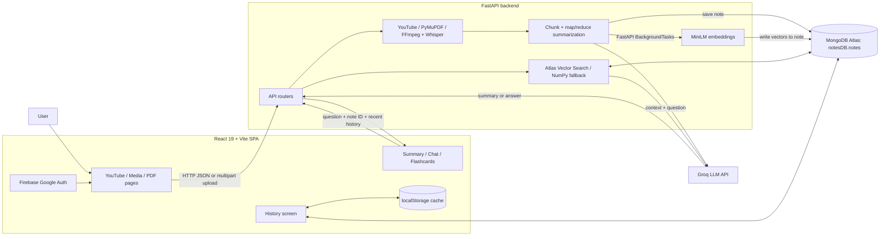

# SmartNotes — Project Interview Revision Sheet

> Use this as a source-grounded interview guide. The “implemented” sections describe the repository today; proposed production improvements are labeled separately. Avoid claiming a benchmark, security feature, or architecture that the code does not contain.

## 1. Project in one sentence

**SmartNotes converts YouTube videos, uploaded audio/video, and PDFs into saved summaries, then lets a user ask questions about a saved note using retrieval-augmented generation (RAG).** It also offers flashcard points, suggested questions, and a notes history.

## 2. The 30-second pitch

> “SmartNotes is a React and FastAPI application for turning long-form learning material into summaries and interactive study notes. The frontend submits a URL or file to the backend. The backend extracts text using a source-specific processor, chunks it, summarizes the chunks with Groq, and stores the result in MongoDB Atlas. It creates MiniLM embeddings for the source text and stores them with the note. For chat, it retrieves relevant chunks using Atlas Vector Search, with a NumPy cosine-similarity fallback, and asks Groq to answer using that context.”

## 3. Architecture at a glance



### Main technologies

| Layer | Implementation | Responsibility |
|---|---|---|
| Frontend | React 19, Vite, React Router | Screens, uploads, result display, client-side routing |
| Frontend auth | Firebase Authentication | Google sign-in and frontend route gating |
| API | Python FastAPI | HTTP endpoints and orchestration |
| LLM | Groq via LangChain `ChatGroq` | Summaries, RAG answers, and fallback generation |
| Database | MongoDB Atlas via PyMongo | Notes and embedded chunk vectors |
| Embeddings | HuggingFace `all-MiniLM-L6-v2` | 384-dimensional dense vectors, loaded/cached in backend process |
| Media | FFmpeg + Faster-Whisper | Audio preparation and local transcription |
| PDF | PyMuPDF (`fitz`) | Extract selectable text from PDF pages |
| YouTube | `youtube-transcript-api` | Retrieve existing transcript/captions |

## 4. Application startup and request lifecycle

1. `frontend/src/main.jsx` mounts the app inside `AuthProvider` and `BrowserRouter`.
2. `AuthContext` listens to Firebase auth state. `ProtectedRoute` gates the dashboard pages in the browser.
3. `backend/main.py` creates the FastAPI app, installs CORS middleware, and registers the API routers.
4. In FastAPI lifespan startup, the backend attempts a MongoDB ping and preloads the MiniLM embedding model.
5. A React page sends an HTTP request to a route. Routes orchestrate services in `backend/app/services/` and database helpers in `backend/app/core/database.py`.
6. For ingestion, the route returns the generated summary and saved note; embedding generation is scheduled using FastAPI `BackgroundTasks`.
7. React updates page state, renders `SummaryPage`, and adds the note to the local history cache.

**Important:** API URLs in the frontend currently use `http://localhost:8000`. This is development configuration; deployment needs a configurable API base URL.

## 5. Feature flows, end to end

### A. YouTube summarization

**Frontend:** `YoutubeSummarizer.jsx` collects the URL and title. `VideoPreview.jsx` can call `GET /transcript/?url=...` to show transcript content. On summarize, the page sends JSON to `POST /summarize-yt`, including `user_id`, title, URL, and transcript if already available.

**Backend:** `backend/app/api/summarizer.py` accepts a provided transcript or fetches one itself. `youtube.py` extracts the video ID, tries English/Hindi transcripts, then fallback fetch/list methods. It normalizes transcript items to timestamp/text pairs.

**Generation and persistence:** Transcript text enters `summarize_long_content()`, which cleans and chunks it, sends chunk calls to Groq, combines the results when needed, saves a `type="youtube"` note in MongoDB, and schedules embeddings from the transcript text.

**Response:** The endpoint returns status, summary, saved note, and process log strings. React displays the summary and adds the note to local history.

**Interview summary:** “The YouTube-specific part retrieves captions. After extraction, it joins the shared ingestion and summarization pipeline used by the other sources.”

### B. Audio/video summarization

**Frontend:** `AudioVideoSummarizer.jsx` packages the selected file, user ID, and type in `FormData`, then calls `POST /summarize-media`.

**Backend:** The route checks the filename extension, creates a UUID/task ID, saves the file under `backend/uploads/{user_id}/`, and calls `process_media_file()`.

**Transcription:** `media_processor.py` tries FFmpeg with `atempo=2.0`, mono audio, and a 16 kHz sample rate. It then loads Faster-Whisper `small`, choosing CUDA/float16 if available or CPU/float32 otherwise, with VAD filtering. The transcript segments include timestamps and text. A temporary speed-adjusted WAV is removed afterward.

**Generation and persistence:** Transcript segments enter the shared Groq summarizer. The note stores the summary, transcript, source path, task ID, and media type; embeddings are scheduled in the background.

**Known implementation caveat:** If Faster-Whisper raises an exception, the current function logs the error and returns placeholder transcript text. Do not describe that fallback as a successful transcription; it should be replaced with an explicit failed state/error in production. Also, the LLM work remains in the HTTP request path.

### C. PDF summarization

**Frontend:** `PdfTextSummarizer.jsx` uploads a PDF as multipart form data to `POST /summarize-pdf`.

**Backend:** The route checks the `.pdf` extension, stores the upload under the user upload directory, and calls `extract_pdf_text()`.

**Extraction:** PyMuPDF reads text page by page and joins non-empty pages. If no selectable text is extracted, it raises an error. Scanned PDFs need OCR, which is not implemented in this path.

**Generation and persistence:** Extracted text uses the shared Groq chunk/map-reduce summarizer. A `type="PDF"` note is stored with extracted text in `pdf_content`; embedding generation is scheduled using the extracted text.

### D. Shared Groq summarization pipeline

Implemented in `backend/app/services/summarizer.py`:

1. Convert source transcript records or raw text to one string.
2. Clean filler terms/whitespace using `clean_transcript_text()`.
3. Split with LangChain `RecursiveCharacterTextSplitter`, default `CHUNK_SIZE=5000` and `CHUNK_OVERLAP=400` **characters**.
4. Summarize each piece with a Groq prompt. A semaphore caps concurrent chunks; default `MAX_CONCURRENT_SUMMARIES=1`.
5. Retry recognized rate-limit/payload failures (e.g. 429/413) with increasing waits, up to the configured retry count.
6. If one chunk exists, return its summary directly. If there are multiple, synthesize their summaries in order. If synthesis fails, return concatenated chunk summaries.

**What to say:** “This is a map/reduce-style strategy: map summarizes manageable pieces, reduce synthesizes the partial summaries. It avoids submitting the entire source as one request, though chunk size and overlap should be evaluated against representative content.”

**Nuance:** `asyncio` keeps the Groq calls awaitable, but audio transcription and local embedding work are CPU/GPU-bound work. This codebase does not yet use a separate worker service for durable, horizontally scalable processing.

### E. Background embedding/indexing

Implemented in `backend/app/services/vector_search.py`:

1. After saving a note, the API schedules `async_generate_and_save_embeddings()` using FastAPI `BackgroundTasks`.
2. The text is split into **600-character** chunks with **120-character** overlap.
3. MiniLM produces one 384-number vector per chunk.
4. Each `{text, embedding}` pair is written into the note’s `embeddings` field in MongoDB.

This avoids waiting for embedding computation before the initial response. FastAPI BackgroundTasks are in-process and not a durable queue: a process crash can lose work, and jobs are not independently scaled or persisted.

### F. RAG chat (“Ask AI”)

**Frontend:** `ChatAssistant.jsx` submits a POST to `/chat` with the current question, note ID, summary, and previous chat messages. The latest four messages are prepared as conversational context in the backend.

**Retrieval:** The question is embedded with MiniLM. `search_vector_context()` first attempts MongoDB Atlas `$vectorSearch` on `embeddings.embedding`, with a note ID filter, `numCandidates=100`, and `limit=4`.

**Fallback:** If Atlas vector search errors or returns no context, it loads the note’s stored vectors and uses NumPy to calculate cosine similarity in application memory, sorting and taking the top four text chunks. NumPy is the similarity calculator; it does **not** replace MiniLM, and it is not the vector database. If no vector result is available, the code can fall back to the summary supplied by the client or the saved note summary.

**Generation:** The backend constructs a prompt with retrieved context, recent chat history, and the user question, then calls Groq with a lower temperature. The response includes the reply and `context_source` label.

**Limits to state honestly:** There is no calibrated confidence threshold, contradiction detector, citation display, reranker, or formal RAG evaluation harness in the inspected implementation. The simple prompt asks for accurate context-based answers but doesn’t guarantee the model will always stay grounded.

### G. Flashcards and suggested prompts

`SummaryPage.jsx` renders the summary, chat, and flashcard tabs.

- `Flashcards.jsx` sends the summary to `POST /summarize-flashcard`. The backend first parses existing markdown bullets/numbered points (requiring at least four useful items); otherwise it asks Groq for six concise points.
- `ChatAssistant.jsx` asks `POST /prompts` for suggested questions. The backend derives questions from Markdown headings first; if there are no headings, it asks Groq for up to three questions.
- The frontend renders results and supports interactions such as flipping cards. These outputs are based on the summary, not an independent source retrieval step.

### H. Notes history and deletion

`historyStorage.js` reads/writes a `localStorage` history cache and dispatches a custom `smartnotes_history_updated` event so components in the same browser window refresh. History initially displays cached data, then calls `GET /notes/?user_id=...` to sync from MongoDB. The backend queries notes for that user, sorted by `created_at` descending. Deletion calls `DELETE /notes/{note_id}` and updates the client cache.

**Nuance:** the code uses a custom window event; this should not be described as server-push or WebSocket database synchronization. A Socket.IO client module exists, but the inspected backend does not register a Socket.IO server for this history flow.

### I. Live meeting transcription

The route/page currently presents a “coming soon” placeholder. It is not a completed live transcription feature.

## 6. API quick reference

| Method and path | Input | What it does |
|---|---|---|
| `POST /summarize-yt` | JSON: user ID, title, URL and/or transcript | Extract/fetch transcript, summarize, save note, schedule embeddings |
| `POST /summarize-media` | Multipart: file, user ID, type | Store upload, transcribe, summarize, save note, schedule embeddings |
| `POST /summarize-pdf` | Multipart: PDF, user ID, type | Extract PDF text, summarize, save note, schedule embeddings |
| `GET /transcript/?url=...` | YouTube URL | Fetch transcript for preview/use |
| `POST /chat` | JSON: message, summary, note ID, history | Retrieve context and generate a RAG reply |
| `POST /summarize-flashcard` | JSON: summary | Extract or generate flashcard points |
| `POST /prompts` | JSON: summary | Extract or generate suggested questions |
| `GET /notes/?user_id=...` | User ID query parameter | Fetch that user’s notes |
| `DELETE /notes/{note_id}` | Note ID in path | Delete note by Mongo ObjectId |
| `GET /` | — | API health message |

## 7. MongoDB note schema

Current database: `notesDB`; collection: `notes`. One note is one MongoDB document. Embeddings are currently embedded in that note document rather than stored in a separate vector database/collection.

```javascript
{
  _id: ObjectId,
  user_id: "Firebase UID",
  title: "Lecture 1",
  type: "youtube" | "media" | "PDF",
  summary: "Generated summary...",
  transcript: [{ time: "00:00", text: "..." }], // optional
  pdf_content: ["Extracted text..."],             // optional
  embeddings: [                                    // populated after background work
    { text: "Chunk text...", embedding: [/* 384 floats */] }
  ],
  source: "URL or local upload path",
  task_id: "UUID, when set by upload flow",
  status: "Completed",
  created_at: ISODate
}
```

**Current query pattern:** history filters by `user_id`; note retrieval/deletion uses Mongo ObjectId; vector search filters to the note ID. Production schema improvements could store each chunk as its own record with `note_id`, `user_id`, chunk index, text, and vector.

## 8. Authentication, security, and reliability: current vs next

### Implemented

- Firebase Google sign-in state in the frontend.
- Browser route protection for dashboard routes.
- Upload extension checks for allowed media types and PDFs.
- API CORS middleware and error handling in several routes.
- Environment variables are used for Mongo URI and Groq API key/model configuration.

### Important gaps / production work

- The backend routes accept `user_id` from the request and do not verify Firebase ID tokens. A frontend route guard is not API authorization.
- Notes fetch is filtered by supplied user ID, but delete is only by note ID; backend ownership checks should be enforced for every operation.
- CORS currently allows all origins while also enabling credentials; production should restrict origins.
- Mongo client is configured with `tlsAllowInvalidCertificates=True`; certificate validation should be enabled for production.
- Files are stored on local backend disk; use object storage, file-size limits, content validation, and lifecycle cleanup.
- Summarization and transcription run before the HTTP response; long jobs can time out. Use a durable queue and job-status endpoint.
- BackgroundTasks are not durable. Add retries, idempotency, persisted state, and dead-letter handling in a worker system.
- The media transcription exception currently falls back to placeholder text. Return a clear failed state instead.
- Add structured logs, request IDs, traces, metrics, token/cost tracking, rate limits, and alerts.

## 9. Scaling plan (interview answer)

> “I would scale according to measured bottlenecks rather than add infrastructure blindly. First I’d move transcription, summarization, and embedding work to durable queues and separate worker pools because CPU/GPU transcription, LLM calls, and embedding workloads have different resource profiles. I’d return a job ID and expose status/progress. I’d move uploads to object storage, add idempotency and bounded retries, and verify Firebase tokens and note ownership on the backend. For retrieval growth, I’d put chunks in a separately indexed collection or a managed vector store, filter by tenant/note metadata, and benchmark recall and latency. I’d monitor queue depth, stage latency, failures, retrieval quality, and token cost.”

### Staged production evolution

1. **Security:** verify Firebase ID tokens; authorize all note operations by authenticated owner; tighten CORS; validate uploads; enable TLS certificate verification.
2. **Async processing:** API creates a job and responds quickly; durable queue (e.g. Redis-backed queue or managed queue); separate CPU/GPU and LLM/embedding workers; persistent job states.
3. **Storage:** object storage for originals; MongoDB for note metadata; separate chunk/vector records or a vector database when dataset/query needs justify it.
4. **Retrieval quality:** tune chunking, metadata filtering, top-k, hybrid lexical/vector retrieval, reranking, and calibrated refusal thresholds using evaluation data.
5. **Reliability and observability:** retries with limits/backoff, idempotency, timeouts, dead-letter queue, logs/metrics/traces, dashboards and alerts.
6. **Capacity/cost:** quotas, caching of deterministic work, batching, provider concurrency control, and autoscaling based on queue depth/latency.

## 10. RAG concepts and interview-ready explanations

### What does MiniLM do? What does NumPy do?

MiniLM converts text into dense vectors that capture semantic similarity. NumPy performs numeric operations on those vectors. In this app, MiniLM embeds both stored text chunks and the query; NumPy is only the fallback cosine-similarity ranking calculation if Atlas Vector Search is unavailable.

### Why chunk documents?

Chunks fit model/input constraints and allow retrieval of focused passages. Overlap helps preserve context across boundaries. Too-small chunks lose context and create many vectors; too-large chunks can mix topics and hurt precision. Tune against representative questions and an evaluation set.

### What is map/reduce summarization?

“Map” summarizes each input chunk independently. “Reduce” combines chunk summaries into a coherent final summary. It handles long content more safely than sending the whole transcript at once, but the synthesis step can still lose details or introduce errors.

### What is RAG?

Retrieval-Augmented Generation fetches relevant source content first, then gives it to an LLM as context. Retrieval improves grounding and lets the app answer about a specific note; it does not guarantee correctness.

### How to debug irrelevant retrieval?

Inspect query normalization and embedding, source chunk boundaries, metadata filters, index configuration, raw retrieved text, and score distribution. Evaluate retrieval separately from generation. Check whether the answer failure is caused by bad context selection or the LLM mishandling good context.

### How to handle conflicting retrieved evidence?

Do not majority-vote automatically. Check source authority, date, and scope; preserve the conflict in the answer if it cannot be resolved. The current app has no explicit conflict resolution mechanism.

### When should RAG refuse?

When evidence is absent, below a calibrated relevance/support threshold, contradictory without resolution, or outside source scope. Use retrieval signals plus answer-support checks; calibrate thresholds on reviewed examples. The current project has a no-context response but no confidence threshold.

### CRAG, Self-RAG, and parent-child chunking

- **CRAG:** evaluates retrieval quality and corrects weak retrieval, e.g. rewrite/query another source. Not implemented here.
- **Self-RAG:** incorporates reflection/self-critique into retrieval and generation decisions. Not implemented here.
- **Parent-child:** retrieve small child chunks for precision, then return a larger parent section for context. Not implemented here.

## 11. Interview Q&A bank

### Product and architecture

**Q1. What problem does SmartNotes solve?**  
It reduces the effort of reviewing long educational or informational content by generating summaries, study points, and grounded Q&A over the source.

**Q2. Explain the architecture.**  
React/Vite frontend and Firebase client auth call FastAPI routes. Backend services extract text, call Groq for summarization/generation, use MiniLM for embeddings, and persist notes/vectors in MongoDB Atlas. Results return to React; history also has a localStorage cache.

**Q3. Why separate routes, services, core, and models?**  
Routes handle transport/request orchestration; services contain feature logic; core modules centralize config, LLM clients and database access; Pydantic models define request/document shapes. This makes shared processing easier to reuse and maintain.

**Q4. What happens after an upload?**  
The route validates and saves the file, extracts text, calls the shared chunk/summarize pipeline, saves a note, schedules embeddings, then returns the summary/note to the UI.

**Q5. What is the source of truth for notes?**  
MongoDB Atlas is persistent storage. localStorage is a client-side cache to make history render quickly.

**Q6. Is this microservices architecture?**  
No. It is a modular frontend plus a single FastAPI backend organized into routers and services. Separating workers/services is a scaling direction, not the current deployment architecture.

### LLM and retrieval

**Q7. Why not send the whole document to Groq?**  
Long inputs may exceed context or provider limits, increase latency/cost, and make processing less robust. Chunking bounds request size; map/reduce creates a final summary.

**Q8. How are rate limits handled?**  
Chunk concurrency is bounded by a semaphore, defaulting to one, and recognized 413/429/rate-limit errors receive incremental retry waits. This is basic in-process handling, not a global distributed rate limiter.

**Q9. Does NumPy replace MiniLM?**  
No. MiniLM creates query/document vectors. NumPy compares them using cosine similarity. It falls back for Atlas vector retrieval, and still needs MongoDB to fetch vectors and MiniLM to embed the query.

**Q10. Is NumPy more accurate than Atlas Vector Search?**  
Not inherently. It computes a direct cosine ranking over the available note vectors and can be a useful small-scale fallback. Atlas uses an indexed retrieval path and is designed to scale; compare recall/latency empirically for a specific index and dataset.

**Q11. What if embedding generation is not finished when the user opens chat?**  
The note may have no embeddings yet. Current fallback can use the supplied or saved summary. A more robust system would persist an indexing status and either wait, show “indexing,” or use a deliberate lexical/summary fallback.

**Q12. What if the vector search returns irrelevant chunks?**  
Inspect chunks, query embedding, index/filter config, and scores. Build retrieval tests. Improvements may include different chunking, metadata filters, hybrid retrieval, reranking, or query rewriting.

**Q13. What if retrieved chunks conflict?**  
Check chronology, authority, and scope; have the answer expose unresolved disagreement rather than choose by vote. No such conflict-resolution logic currently exists.

**Q14. What evaluation metrics would you use?**  
Retrieval: Recall@k, MRR, nDCG, context precision/recall. Generation: correctness, faithfulness/groundedness, answer relevance, and refusal quality. Also track latency, error rate, and token cost. The repo has no formal evaluation harness today.

**Q15. How can you evaluate without ground truth?**  
Create reviewed synthetic questions from source material, have domain reviewers label a sample, and use an LLM judge as a triage signal with human spot checks. Track user correction/feedback too; don’t treat an LLM judge as perfect ground truth.

### Data, reliability, and security

**Q16. Why MongoDB?**  
The document model naturally stores a note’s summary and source-specific fields together. Atlas can also provide vector search. The current schema embeds vectors inside each note, which is convenient for a prototype but can grow large.

**Q17. What is the current vector database?**  
There is no separate vector database. MongoDB Atlas stores vectors in the note’s `embeddings` array and the code attempts Atlas Vector Search. NumPy is an in-process fallback calculation.

**Q18. What happens if Atlas Vector Search is down?**  
If the note and vectors are fetched from MongoDB, the code tries NumPy cosine similarity. It can then fall back to a summary. If MongoDB itself is down, vectors can’t be fetched; this is not an independent database failover.

**Q19. Is Firebase auth enforced by the backend?**  
Not in the inspected implementation. Firebase auth gates React routes, but API handlers accept client-provided user IDs and do not verify Firebase ID tokens. Production must verify tokens and check resource ownership server-side.

**Q20. What are the main reliability gaps?**  
Synchronous long-running work, non-durable FastAPI background tasks, local file storage, no persisted job status/retry queue, weak error fallback for Whisper, and limited observability. A queue/workers and explicit job state would address the most important operational risks.

**Q21. What would you change for production security?**  
Verify Firebase ID tokens on every protected API request; derive user identity server-side; enforce ownership for fetch/delete/chat; restrict CORS; validate file contents/size; store secrets only on backend; enable TLS certificate validation; add rate limits and audit logs.

### Scale and design choices

**Q22. What changes from 1,000 to 1 million documents?**  
Separate chunks from note documents, index vectors and metadata, partition/shard according to access patterns, use durable ingestion and worker pools, batch embedding, object storage for files, and load-test at target concurrency. Monitor recall as well as latency.

**Q23. Why might retrieval accuracy drop at larger corpus size?**  
Approximate-index recall, weaker filtering, duplicate/noisy chunks, embedding/domain mismatch, changed query distribution, or flawed evaluation. Compare exact and approximate retrieval on the same labeled query set and isolate retrieval from generation.

**Q24. How do you reduce latency without sacrificing quality?**  
Measure stages first. Cache repeated embeddings/results where safe, batch embedding, tune ANN parameters with recall tests, limit context to useful chunks, stream LLM output, and decouple long jobs. Keep quality gates for every optimization.

**Q25. Why use 5,000 and 600 character chunks?**  
They are current configuration values for different tasks: larger chunks for LLM summary calls, smaller chunks for semantic retrieval. They are characters, not tokens. The source doesn’t show a benchmark proving these values optimal; I’d tune them using evaluation data.

**Q26. What are the trade-offs of chunk size?**  
Small chunks improve precision but may remove context and increase vector count. Large chunks preserve context but mix topics and consume prompt tokens. Overlap helps at boundaries but increases storage/redundancy.

**Q27. Which chunking strategies do you know?**  
Fixed-size with overlap, sentence/paragraph-based, recursive splitting, and structure-aware splitting by headings/pages/code/tables. Use document structure when possible rather than assuming one splitter is ideal for every source.

**Q28. What alternatives did you evaluate?**  
Be precise: the implementation has Atlas vector search plus a NumPy fallback, local MiniLM embeddings, Groq generation, and local Faster-Whisper. Unless you ran documented tests, describe them as selected design choices—not as benchmarked winners over Pinecone/OpenAI/Gemini or cloud transcription.

**Q29. What metric is the current approach better on?**  
Without a benchmark, don’t claim better accuracy or latency. Say it keeps the prototype relatively simple and uses Atlas already used for persistence, with a small-scope fallback. State what metric you would measure next.

**Q30. When would you replace the current approach?**  
When measured latency, recall, scale, reliability, or cost misses requirements. For instance, move off embedded vectors/NumPy when note or chunk volume makes retrieval too slow or Mongo documents unwieldy; change chunking/model only if evaluation shows a real quality improvement.

### Processing details and edge cases

**Q31. What are the source-specific extraction limitations?**  
YouTube requires accessible captions/transcripts; PDFs need extractable text (no OCR path); media transcription requires FFmpeg/model dependencies and local CPU/GPU. Each needs clear failure states and limits in production.

**Q32. Why generate embeddings after the summary response?**  
To reduce user-perceived wait for the primary summary. The trade-off is that chat may be available before vectors are ready, and in-process background work can be lost on restart.

**Q33. Why local transcription?**  
It avoids a separate hosted transcription API and keeps audio processing local to the backend, but consumes CPU/GPU and memory and complicates horizontal scaling. A production choice depends on privacy, throughput, hardware, and cost.

**Q34. What is the biggest technical limitation?**  
For production, a major gap is that long-running work is synchronous and background embedding tasks are not durable. Another critical gap is server-side auth/ownership enforcement. Prioritize based on user and deployment requirements.

**Q35. What would you build next?**  
Secure API authorization, durable jobs with status/progress, robust transcription error states, a regression evaluation dataset for retrieval/answers, and observability. Then optimize storage/vector layout from measured traffic.

## 12. Three-minute spoken walkthrough

> “SmartNotes is a full-stack study assistant for YouTube, audio/video, and PDF content. The frontend is a React single-page app with Firebase Google sign-in. It calls a FastAPI backend, which has route handlers separated from service logic.
>
> Each input has a different extraction step: YouTube uses captions, PDFs use PyMuPDF, and uploaded media uses FFmpeg and Faster-Whisper. Once extracted, all three share a summarization pipeline: clean the text, split it into overlapping chunks, summarize each chunk through Groq, and synthesize a final summary when there are multiple chunks. The note is saved to MongoDB Atlas.
>
> After saving, FastAPI schedules embedding generation in a background task. MiniLM creates 384-dimensional vectors for smaller source chunks, and those vectors are stored in the note document. For chat, MiniLM embeds the question. The backend tries Atlas Vector Search first and falls back to NumPy cosine similarity over the selected note’s vectors. It sends the retrieved text and recent chat history to Groq, then returns the answer to React.
>
> Flashcards and suggested prompts first parse the existing summary locally, then use Groq if there isn’t enough structured text. History is cached in localStorage and synchronized from MongoDB. The current implementation is a prototype: I’d next add backend token verification and ownership checks, durable background queues, object storage, and a measured RAG evaluation suite.”

## 13. Last-minute reminders

- Say **“384-dimensional embeddings from MiniLM”**; say **“NumPy computes cosine similarity”**. They are separate roles.
- Say **“vectors are stored in MongoDB Atlas in the note’s `embeddings` array”**; there is no separate vector DB in the implementation.
- Say **“chunk sizes are characters: summary 5,000/400 overlap; embeddings 600/120 overlap.”**
- Say **“FastAPI BackgroundTasks”**, not “a durable job queue.”
- Say **“Firebase client auth is present; backend token verification is missing.”**
- Don’t claim OCR, live meeting transcription, contradiction handling, confidence scoring, CRAG/Self-RAG, citations, formal evaluation, or production benchmarking are implemented.
- Distinguish the existing prototype from the production architecture you would build next.

## 14. Source map for follow-up study

| Area | Main files |
|---|---|
| App routes and auth | `frontend/src/App.jsx`, `frontend/src/main.jsx`, `frontend/src/context/AuthContext.jsx` |
| YouTube UI and API | `frontend/src/pages/YoutubeSummarizer.jsx`, `frontend/src/components/VideoPreview.jsx`, `backend/app/api/summarizer.py`, `backend/app/services/youtube.py` |
| Media/PDF | `frontend/src/pages/AudioVideoSummarizer.jsx`, `frontend/src/pages/PdfTextSummarizer.jsx`, `backend/app/services/media_processor.py` |
| Summary pipeline | `backend/app/services/summarizer.py`, `backend/app/core/llm.py`, `backend/app/core/config.py` |
| RAG and embeddings | `frontend/src/components/ChatAssistant.jsx`, `backend/app/api/chat.py`, `backend/app/services/vector_search.py` |
| Flashcards and prompts | `frontend/src/components/Flashcards.jsx`, `backend/app/api/flashcards.py` |
| MongoDB and schema | `backend/app/core/database.py`, `backend/app/models/schemas.py`, `backend/app/api/notes.py` |
| History | `frontend/src/pages/History.jsx`, `frontend/src/utils/historyStorage.js` |
| App startup | `backend/main.py` |
